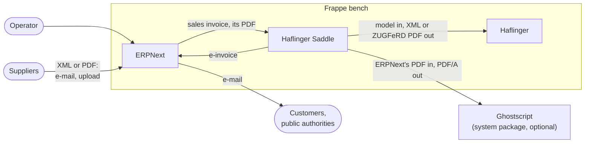

# Haflinger Saddle architecture

Compact [arc42](https://arc42.org/): all twelve sections in this file, until one of them outgrows it. It describes the design that the [ADRs](adr/README.md) set out. Where the code disagrees, the code wins and this file is fixed.

**State:** planning; there is no code yet. Sections 5 to 8 and 10 follow with it.

## 1. Introduction and goals

Haflinger Saddle is a Frappe app that brings e-invoicing into ERPNext, built on the [Haflinger](https://github.com/Interlusion/haflinger) library. It writes sales invoices as XRechnung or ZUGFeRD and, later, turns incoming invoices into purchase invoice drafts that a person reviews. Haflinger holds the model of the EN 16931 business terms, the formats and the official rules; the app maps ERPNext's documents to and from that model ([ITEM-001](../backlog/item-001-invoices-in-erpnext.md)).

### Quality goals

| # | Goal | Meaning |
| :- | :- | :- |
| 1 | **Correctness** | An invoice says what the ERPNext document says: no amount, party or date lost, changed or guessed on the way. |
| 2 | **Easy to install** | It installs like any other app, on one's own server, in Docker or on Frappe Cloud, with nothing else to host ([ADR-001](adr/ADR-001-a-frappe-app.md)). |
| 3 | **Safety with incoming files** | Incoming invoices come from anyone; they are read only through Haflinger, in a background job, with a size limit. |

### Stakeholders

| Who | Expects |
| :- | :- |
| Operator (runs the books in ERPNext) | Invoices sent in the format the customer needs, and incoming ones as drafts to check, without leaving ERPNext |
| Administrator (installs and updates the bench) | One app to install, and a plain message where something is missing |
| Maintainer (keeps the app current, usually an agent with a person reviewing) | Format knowledge in Haflinger, the ERPNext side testable on its own |

## 2. Constraints

| Constraint | Why |
| :- | :- |
| GPL-3.0 | The app imports ERPNext (HAFL-ADR-009) |
| Runs in a Frappe bench | [ADR-001](adr/ADR-001-a-frappe-app.md) |
| Haflinger's public API only, `haflinger` and `haflinger.pdf` | HAFL-ADR-012 |
| No format knowledge of its own | It lives in Haflinger (HAFL-ADR-001) |
| "ERPNext" and "Frappe" not in the name | Frappe's trademark policy |

## 3. Context and scope

**Out of scope:** the formats and the official rules (Haflinger); Peppol, which goes through a certified provider; bookkeeping decisions, which a person makes in ERPNext.

## 4. Solution strategy

A Frappe app in the bench, with nothing else to host; XML everywhere, the ZUGFeRD PDF where Ghostscript is installed ([ADR-001](adr/ADR-001-a-frappe-app.md)).

## 9. Architecture decisions

The [ADR index](adr/README.md).

## 11. Risks and technical debt

| Risk | Where it is followed |
| :- | :- |
| `saxonche`'s licence beside the GPL-3.0 app is unsettled | [ITEM-002](../backlog/item-002-saxonche-licence.md) |
| Frappe Cloud may not install Ghostscript for an app from its Marketplace | [ITEM-001](../backlog/item-001-invoices-in-erpnext.md) |
| `saxonche` under Frappe's workers is untested under load | [Backlog](../backlog/backlog.md) |

## 12. Glossary

The terms of e-invoicing are in Haflinger's [E-Invoicing 101](https://github.com/Interlusion/haflinger/blob/main/docs/guides/e-invoicing-101.md).
